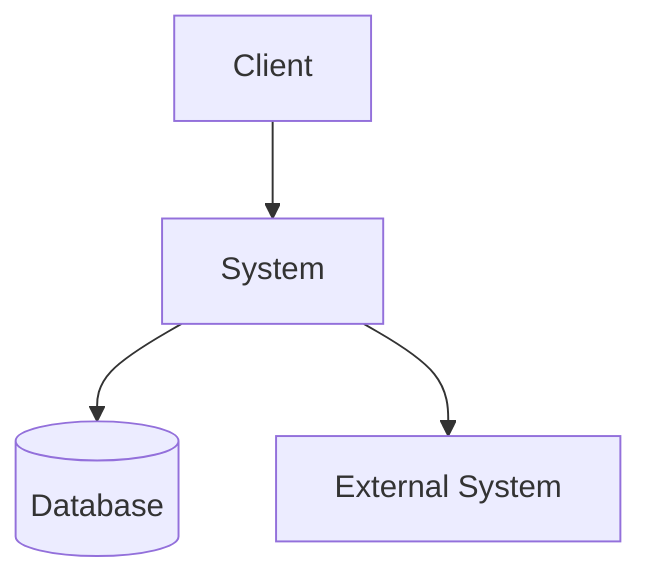

# アーキテクチャ

## 1. 構成概要

## 2. システムコンテキスト

## 3. コンポーネント構成

| Component | Responsibility | Depends On | Evidence |
|---|---|---|---|

## 4. 依存関係

## 5. レイヤー/境界

## 6. 設計上の特徴

## 7. 注意すべき結合

## 8. 未確認事項
