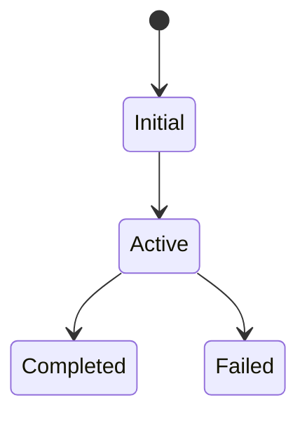

# 業務ロジック

## 1. Domain concepts

## 2. Business rules

| Rule ID | Condition | Action | Exception | Evidence |
|---|---|---|---|---|

## 3. State transitions

## 4. Validation

## 5. Calculation/transformation

## 6. Invariants

## 7. 未確認事項
