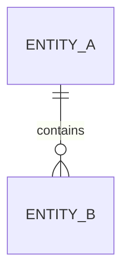

# データモデル

## 1. Overview

## 2. ER model

## 3. Entity/table catalog

| Entity | Purpose | PK | Relations | Evidence |
|---|---|---|---|---|

## 4. Lifecycle

## 5. Transaction boundaries

## 6. Important indexes/constraints

## 7. Data transformations
