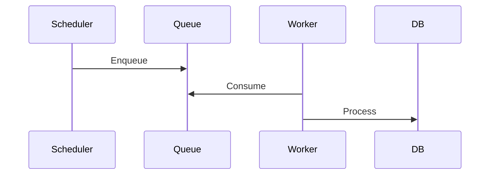

# バッチ・非同期処理

## 1. Overview

## 2. Trigger

## 3. Queue/event/job

## 4. Worker/consumer

## 5. Processing sequence

## 6. Retry/backoff

## 7. Concurrency

## 8. Idempotency

## 9. Dead-letter/failed state

## 10. Evidence
